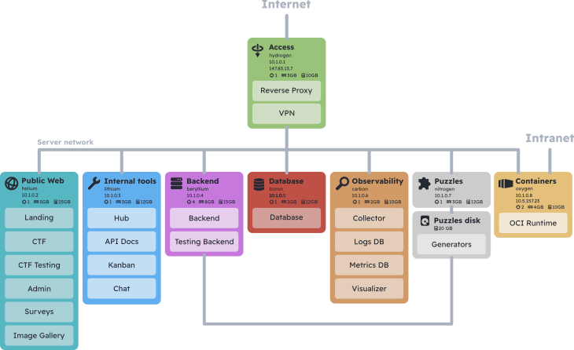

# VilaHack infrastructure

This repository contains all of the Nix files required to replicate VilaHack's
infrastructure.

The VilaHack infrastructure consists of 8 virtual machines and 3 networks.

The access machine (hydrogen) acts as a router, firewall and VPN server. It
controls access from the public internet to the internal vlan, where all the
other machines are found. The third network is UPC's intranet, from where
puzzle containers should be accessible for participants.

Since the responsibilities of every machine are fairly granular, the setup is
highly customizable. For example, if you wanted to outsource the telemetry
collection to a SaaS, you could skip the telemetry machine. You could also skip
the telemetry machine if you didn't want telemetry at all.

In case you wanted to reduce the number of required machines, it is possible to
combine the responsibilities of several into a single one. This can by acheived
by copying the Nix files for a machine into another machine. If a file with the
same path exists in both, some manual merging might be necessary.
