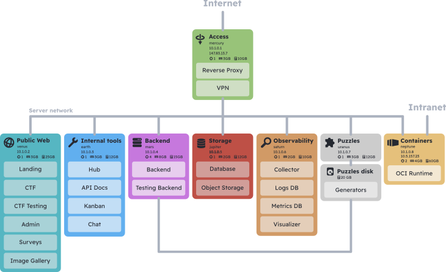

# 


This repository contains all of the Nix files required to replicate VilaHack's
infrastructure.



The VilaHack infrastructure consists of 8 virtual machines and 3 networks.

The access machine (mercury) acts as a router, firewall and VPN server. It
controls access from the public internet to the internal VLAN, where all the
other machines are found. The third network is UPC's intranet, from which
participants should be able to access puzzle containers.

Since the responsibilities of every machine are fairly granular, the setup is
highly customizable. For example, if you wanted to outsource the telemetry
collection to a SaaS, you could skip the telemetry machine. You could also skip
it if you didn't want telemetry at all.

In case you wanted to reduce the number of required machines, it is possible to
combine the responsibilities of several into a single one. This can be achieved
by copying the Nix files for a machine into another machine. If a file with the
same path exists in both, some manual merging might be necessary.

## Deploying the configuration
In order to deploy the configuration it is important to understand how it is
structured. It is organized into three directories: `common`, `machines` and
`users`.

### `common/`
Contains things that stay the same accross every machine. You should
practically never have to touch it. It contains:
 - The SSH configuration
 - Platform, Bootloader and OS configuration
 - Shared networking configuration
 - Security configuration
 - Basic packages for managing the machine

### `machines/`
Has the configurations specific to the purpose of each machine. Each machine's
configuration will usually consist of two sub-directories:

- `system/`
 
  Defines machine-specific system configuration like the machine's IP address
  and disks

- `services/`

  Defines the services provided by that machine

Each machine’s ``default.nix`` should also import the user definitions for that
machine.

### `users/`
Where the users are defined. The same user might want to be able to access
several different machines. To avoid repetition of user definitions among
machine configs, users are kept in the `users/` directory and then imported
as needed in each of the machines' specific configs.

The `configuration.nix` file imports the `common/` module. When deploying each
machine, a machine-specific config directory should be imported by uncommenting
the relevant line in `configuration.nix`.

## Useful commands for Nix novices
If you're looking to manage the infrastructure you should be aware of the
following commands:

Rebuild the system state from the configuration and immediately switch to it:
```sh
nixos-rebuild switch
```

Rebuild the system state from the configuration and add a boot entry to it:
```sh
nixos-rebuild boot
```
This means that the system won't immediately switch to the newly generated state
but that it will become available on the next restart. It will appear at the top
of the boot menu, becoming the default option.

Upgrade the system:
```sh
nixos-rebuild switch --upgrade # Boot can also be used in place of switch.
```

Delete old generations:
```sh
nix-collect-garbage -d
```
This will help free up space used by the Nix store. The garbage collector is
configured to run periodically, but this will run immediately.

## Other tips
The VPN configuration is located at `machines/mercury/services/wireguard.nix`.
This is the file you have to edit if you're looking to add or remove clients
from the VPN.
